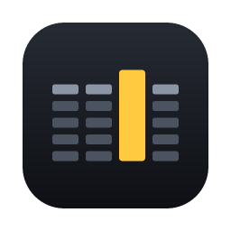
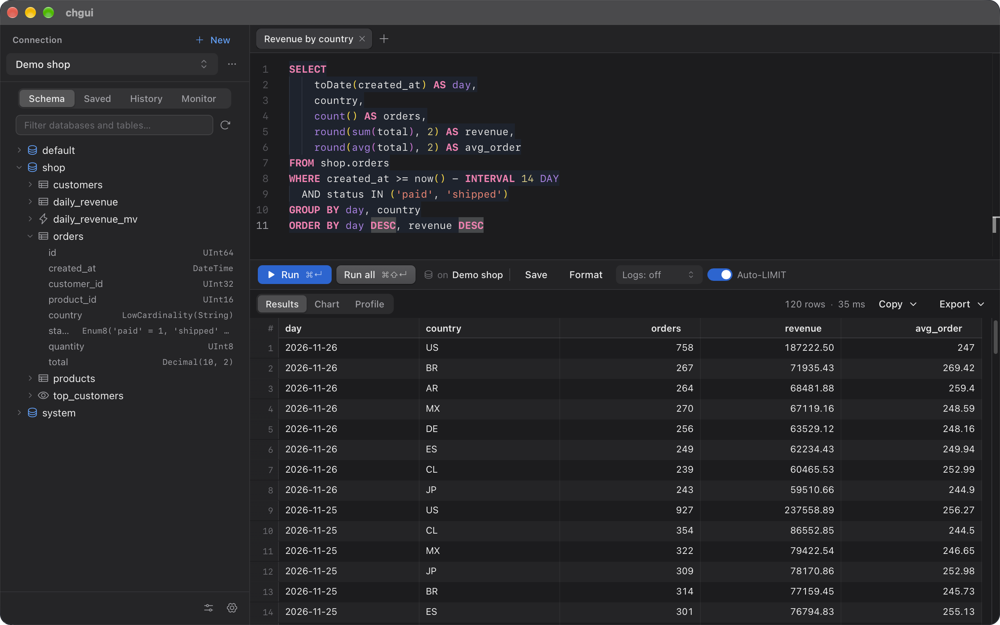

<p align="center">
  
</p>

<h1 align="center">ch-gui</h1>

<p align="center">
  A ClickHouse client for macOS that speaks the native TCP protocol.
</p>

<p align="center">
  <a href="https://downloads.matiasdominguez.dev/chgui_aarch64.dmg"><b>Download for macOS</b></a>
  &nbsp;·&nbsp;
  <a href="https://github.com/matiasdominguez/ch-gui/releases">Release notes</a>
  &nbsp;·&nbsp;
  <a href="docs/development.md">Build from source</a>
</p>

<p align="center">
  
</p>

## Why

Every ClickHouse GUI I tried connects over HTTP, usually through a generic
JDBC driver. `clickhouse-client` connects over the native TCP protocol, and the
server tells a native client more. It reports progress while a query runs, and
it can send the query's log lines as they are written. I wanted both in a
desktop app, so ch-gui speaks the native protocol.

- A running query shows rows read, bytes read, and percent done.
- The Logs panel shows the server's log lines for your query, at any level
  from `error` to `trace`.
- ch-gui connects on port 9000 or 9440, the ports `clickhouse-client` uses. The
  HTTP port can stay closed.

Most of those GUIs are also general database clients. ch-gui works only with
ClickHouse, so it has panels for what ClickHouse operators check: parts and
merges, failed materialized views, Kafka consumers, replication queues, and
`system.errors`.

## Install

1. Download
   [`chgui_aarch64.dmg`](https://downloads.matiasdominguez.dev/chgui_aarch64.dmg).
   That link always serves the newest version.
2. Open it and drag **chgui** to Applications.
3. Add a connection. Use port `9440` with **Secure** on.

ch-gui needs macOS 11 or later on Apple silicon. Intel Macs are not supported.
The app is signed with a Developer ID and notarized by Apple, and it installs
its own updates.

Download ch-gui only from `downloads.matiasdominguez.dev`. To check a download,
run `shasum -a 256` on the file and compare the result with the SHA-256 on the
newest entry in [Releases](https://github.com/matiasdominguez/ch-gui/releases).

## Features

### Editor

- The editor is Monaco. It completes keywords, databases, tables, columns, and
  table aliases, and it shows ClickHouse function docs on hover.
- **⌘↵** runs the statement under the cursor, or the selection. **⌘⇧↵** runs
  every statement in order and stops at the first error.
- **⌘.** cancels a query and stops it on the server.
- `{name}` placeholders become input fields under the editor. Text values are
  quoted for you. See [the security model](docs/security-model.md).
- You can save queries, and the app keeps a history of every query you ran.
  The History tab can also read the server's `system.query_log`.
- The Saved tab includes ten sample queries for health checks, such as the
  largest tables and the slowest queries.
- Tabs keep their SQL and parameter values when you quit.
- A failed query has a **Copy for LLM** button. It copies the SQL as run, the
  full error, and the server version.

### Results

- The grid draws only the rows and columns on screen, so a wide `SELECT *`
  stays fast.
- Drag to select cells. Copy them as TSV, CSV, Markdown, JSON, SQL `VALUES`, or
  a Python list. Export to CSV, TSV, or JSON Lines.
- Double-click a cell to see its whole value. JSON is formatted.
- A `SELECT` with no `LIMIT` returns at most 10,000 rows. A badge says when the
  limit applied, and **Run without limit** fetches the rest.
- Any result with a numeric column can be drawn as a bar or line chart.
- The **Profile** tab shows duration, peak memory, rows read, and the parts and
  marks the query selected.
- 64-bit and larger numbers keep every digit.

### Schema

- The sidebar lists databases, tables, and columns, and it has a search box.
  Double-click a table to preview 100 rows.
- The table panel shows columns, keys, partitions, parts and merges, projections,
  the `CREATE TABLE` statement, and the views that read from the table.
- The column panel shows null and unique counts, the minimum and maximum, and a
  histogram or the most frequent values.
- A dependency graph shows the views and materialized views around a table.
- **Compare two tables…** in the **⌘P** palette lists the columns that differ.
- **Δ** lists every server setting that differs from the ClickHouse default.

### Monitor

- **Server Activity** lists recent errors, failed materialized views, pending
  mutations, and replication queues.
- **Live Queries** lists running queries, with a **Stop** button on the ones
  you may stop.
- **Kafka** shows consumer health for Kafka tables.

Each panel refreshes on its own interval, set in Settings. If your account
cannot query the whole cluster, the panels read the node you are connected to.

## Keyboard shortcuts

| Keys         | Action                                               |
| ------------ | ---------------------------------------------------- |
| **⌘↵**       | Run the selection, or the statement under the cursor |
| **⌘⇧↵**      | Run every statement                                  |
| **⌘.**       | Cancel the running query                             |
| **⌘⇧L**      | Format the query                                     |
| **⌘S**       | Save the query                                       |
| **⌘T**       | Open a new tab                                       |
| **⌘⇧T**      | Reopen the last closed tab                           |
| **⌘P**       | Open the command palette                             |
| **⌘,**       | Open Settings                                        |
| **⌘?**       | List every shortcut                                  |

## Connecting over TLS

- Use port `9440` and turn on **Secure**.
- If a VPN or proxy between you and the server inspects TLS with a private CA,
  paste that CA's PEM into the connection's **Custom CA certificate** field.
  Otherwise the app trusts the macOS system certificates.
- With **Secure** off, your password and query results cross the network
  unencrypted. The connection form warns you when the host is remote.

## Privacy and security

- Passwords stay in the macOS Keychain.
- Query history and open tabs are stored unencrypted on your Mac. A statement
  that contains a secret is saved as typed.
- ClickHouse servers receive your OS username and hostname, as they do from
  `clickhouse-client`.
- The only other network traffic is the update check to
  `downloads.matiasdominguez.dev`.

[The security model](docs/security-model.md) has the details. Report security
problems as [SECURITY.md](SECURITY.md) describes.

## Build from source

```bash
git clone https://github.com/matiasdominguez/ch-gui.git
cd ch-gui
npm install
npm run tauri dev
```

You need macOS with the Xcode command line tools, Rust from rustup, and Node 22
or 24. [docs/development.md](docs/development.md) covers builds, tests, and the
Docker test server.

## How it is built

ch-gui is built with Tauri 2, React 19, and Rust.
[docs/architecture.md](docs/architecture.md) explains how a query travels
through the app and lists the patches in the vendored `klickhouse` driver.
[CONTRIBUTING.md](CONTRIBUTING.md) says how to send a change.

## License

ch-gui is under the [MIT license](LICENSE). The vendored `klickhouse` crate keeps
its own [MIT](vendor/klickhouse/LICENSE-MIT) and
[Apache 2.0](vendor/klickhouse/LICENSE-APACHE) licenses.
